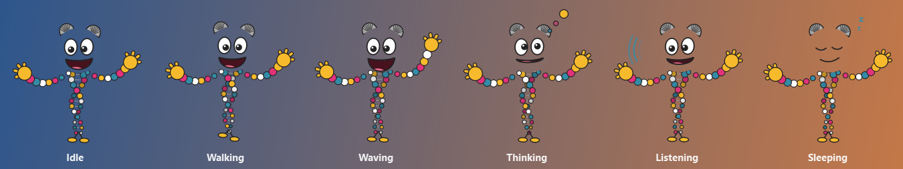
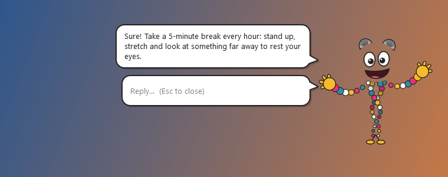
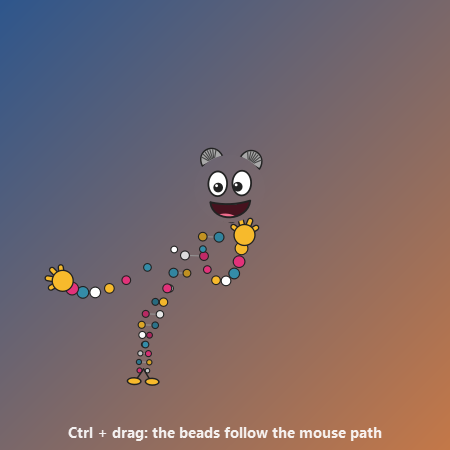

# Elyca

**Una piccola compagna AI che vive sul desktop di Windows.**
Elyca è una mascotte animata, una doppia elica di perline colorate con una grande faccia sorridente, che
passeggia lungo il bordo destro dello schermo senza mai darti fastidio. La chiami con una hotkey e ti
risponde con un **modello AI gratuito e locale** ([Ollama](https://ollama.com)), per iscritto o a voce.

*[Read in English](README.md)*



## Caratteristiche

- **Mai d'intralcio**: trasparente e sempre in primo piano, i clic le passano attraverso, non ruba mai
  il focus, si sposta quando il mouse si avvicina e si nasconde quando guardi qualcosa a schermo intero
  (video, presentazioni, giochi).
- **Chat in un fumetto**: premi `Ctrl+Alt+E`, scrivi, e continua la conversazione direttamente sotto il fumetto.
- **Gratis e privata di default**: le risposte arrivano da Ollama sul tuo PC; nessun account, nessuna chiave.
  Il modello viene scaricato da solo la prima volta.
- **Voce (opzionale)**: tieni premuto `Ctrl+Alt+V` e parla (dettatura con faster-whisper, offline sulla
  CPU); le risposte possono essere lette ad alta voce con le voci di Windows.
- **Viva**: ondeggia, cammina, saluta, pensa, ascolta, si addormenta quando non ci sei, segue il cursore
  con gli occhi e le perline la seguono in ritardo quando si muove o la trascini.
- Interfaccia **in italiano e in inglese**, scelta in automatico da Windows.
- Supporta più monitor e lo scaling DPI, circa 1% di CPU, menu nel tray, un solo `.exe`.



## Requisiti

- Windows 10 o 11 (64 bit)
- [Ollama](https://ollama.com/download) installato e avviato (gratuito). Alla prima domanda Elyca scarica
  il suo modello predefinito (`qwen2.5:3b`, circa 2 GB).
- Per la voce: un microfono e circa 0,5 GB di spazio per il modello vocale (scaricato al primo uso).

## Avvio rapido (exe)

1. Installa [Ollama](https://ollama.com/download).
2. Scarica `Elyca.exe` dalla pagina [Releases](../../releases) e mettilo in una cartella tutta sua
   (accanto a sé crea `config.json` e `logs\`).
3. Doppio clic su `Elyca.exe`. Premi **`Ctrl+Alt+E`** e salutala.

## Avvio dal codice sorgente

```powershell
git clone https://github.com/Maurus1988kk/MsElyca.git
cd MsElyca
py -3.11 -m venv .venv
.\.venv\Scripts\Activate.ps1
pip install -r requirements.txt
python main.py
```

Oppure doppio clic su `avvia_elyca.cmd`, che la avvia senza finestra del terminale (chiudere il terminale
non la chiude). Se PowerShell blocca `Activate.ps1`: `Set-ExecutionPolicy -Scope CurrentUser RemoteSigned`.

## Come si usa

| Cosa | Come |
|---|---|
| Scriverle | **`Ctrl+Alt+E`** apre la casella; **Invio** invia. La casella **resta aperta sotto la risposta**, così continui a chattare. **Esc** (o di nuovo `Ctrl+Alt+E`) chiude la conversazione e ridà il focus all'app di prima; si chiude anche con un clic altrove o dopo 2 minuti senza scrivere. |
| Parlarle | Con `voice.enabled: true`: **tieni premuto `Ctrl+Alt+V`** mentre parli e rilascia quando hai finito. Il testo viene inviato come una domanda scritta (anche dentro una conversazione aperta). |
| Spostarla | Tieni premuto **Ctrl** e trascinala. Poi torna camminando al bordo destro di quel monitor. |
| Menu | Tasto destro sull'icona nel tray, oppure **Ctrl + tasto destro sulla mascotte**: Mostra/Nascondi, Pausa movimento, Fallo dormire, Dimentica la conversazione, Leggi le risposte ad alta voce, Apri config, Esci. |

> **Non vedi l'icona nel tray?** Windows 11 nasconde le icone nuove. Usa Ctrl + tasto destro sulla mascotte,
> oppure attiva Elyca in *Impostazioni → Personalizzazione → Barra delle applicazioni → Altre icone della barra*.



## Configurazione

Le impostazioni sono in `config.json`, creato accanto a `main.py` / `Elyca.exe` al primo avvio
(menu → *Apri config*). Dopo averlo modificato, riavvia Elyca. Le chiavi nuove vengono aggiunte da sole
quando aggiorni Elyca. **Non modificare `config.py`**: contiene solo i valori iniziali.

| Chiave | Default | Significato |
|---|---|---|
| `general.ui_language` | `auto` | Lingua dell'interfaccia: `auto` (da Windows), `it`, `en` |
| `brain.backend` | `ollama` | `ollama` (gratuito, locale) oppure `anthropic` (Claude, vedi sotto) |
| `brain.ollama_model` | `qwen2.5:3b` | Qualsiasi modello della [libreria Ollama](https://ollama.com/library) |
| `brain.ollama_auto_pull` | `true` | Scarica il modello da solo se manca |
| `brain.history_turns` | `6` | Scambi domanda/risposta ricordati (solo in memoria) |
| `brain.system_prompt` | | Personalità e stile delle risposte |
| `hotkeys.chat` / `hotkeys.push_to_talk` | `Ctrl+Alt+E` / `Ctrl+Alt+V` | Modificatori: `Ctrl`, `Alt`, `Shift`, `Win`; tasti: lettere, cifre, `F1`–`F24`, `Space`… |
| `voice.enabled` | `false` | Attiva dettatura e lettura ad alta voce |
| `voice.whisper_model` | `small` | `small` (veloce) oppure `medium` (più preciso, più lento) |
| `voice.whisper_language` | `auto` | `auto` = lingua dell'interfaccia, `""` = riconoscimento automatico, oppure un codice come `it` |
| `voice.tts_voice` / `voice.tts_rate` | `""` / `185` | Parte del nome di una voce di Windows (vuoto = la prima nella lingua dell'interfaccia), velocità |
| `mascot.height_px` | `120` | Dimensione della mascotte |
| `mascot.sleep_after_minutes` | `5` | Si addormenta dopo questi minuti di inattività (`0` = mai) |
| `mascot.trail_delay_s` | `0.3` | Quanto le perline restano indietro quando si muove (`0` = disattivato) |
| `overlay.hide_on_fullscreen` | `true` | Nascondersi con un'app a schermo intero |
| `bubble.conversation_timeout_s` | `120` | Chiude la casella dopo questi secondi senza scrivere (`0` = mai) |

In `config.py` trovi tutte le opzioni con un breve commento.

### Opzionale: Claude (API Anthropic)

Per risposte più intelligenti puoi passare a Claude: metti `brain.backend` a `anthropic`, crea una chiave
API su [platform.claude.com](https://platform.claude.com) e salvala una volta come variabile d'ambiente:

```powershell
setx ANTHROPIC_API_KEY "sk-ant-..."
```

Poi chiudi e riapri terminali/IDE aperti e riavvia Elyca. Il modello predefinito è `claude-haiku-5-5`
(`brain.anthropic_model`). L'uso dell'API è a pagamento (fatturato da Anthropic). Non mettere mai la
chiave in `config.json`.

## Risoluzione dei problemi

`Elyca.exe --selftest` (oppure `python main.py --selftest`) controlla interfaccia, Ollama, microfono,
sintesi vocale, Whisper e l'SDK di Claude senza aprire finestre, e scrive il resoconto in
`logs\selftest.txt`. Il log normale è `logs\elyca.log`.

## Creare l'exe

```powershell
.\build_exe.ps1               # crea dist\Elyca.exe
.\build_exe.ps1 -CopyModels   # ...e ci copia accanto il modello vocale già scaricato
```

Lo script genera l'icona (`packaging\elyca.ico`, disegnata dallo stesso codice della mascotte) e compila
con `Elyca.spec` (file unico, senza console, informazioni di versione da `packaging\version_info.txt`).
`python packaging\make_screenshots.py` rigenera le immagini in `docs\`.

## Struttura del progetto

```
main.py              avvio, logging, istanza singola, --selftest
config.py            default di config.json e unione delle chiavi
i18n.py              testi dell'interfaccia (italiano / inglese)
selftest.py          autodiagnosi
mascot/              disegno (QPainter, nessuna immagine), stati di animazione, movimento, scia delle perline
overlay/             finestra trasparente, Win32 (click-through, focus, hotkey, schermo intero),
                     fumetti, icona nel tray
brain/               backend AI con un'interfaccia comune: Ollama (default), Anthropic (opzionale)
voice/               registrazione push-to-talk, dettatura faster-whisper, sintesi vocale pyttsx3
packaging/           icona, informazioni di versione, generatore di screenshot
```

**Aggiungere un nuovo backend AI:** crea `brain/<nome>_backend.py` con una sottoclasse di `Backend`
(`brain/base.py`) che restituisca la risposta a pezzi di testo, e registrala in `make_backend()` in
`brain/__init__.py`.

## Licenza

[MIT](LICENSE)
